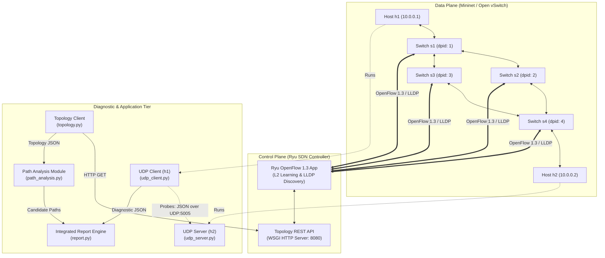
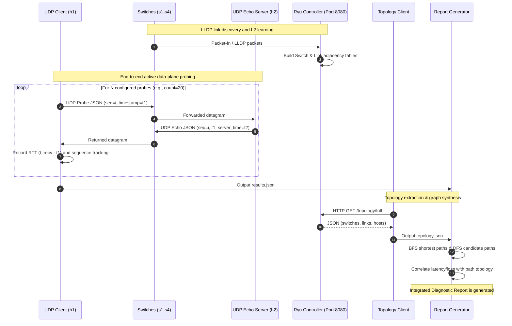

# Network Diagnostic and Path Analysis Tool: System Architecture

## 1. Project Overview & Objectives

The **Network Diagnostic and Path Analysis Tool** is an educational, hybrid networking platform developed for software-defined networks (SDN). The project integrates end-to-end transport layer diagnostics (UDP socket probing) with control plane intelligence (OpenFlow 1.3 topology discovery and path analysis).

### Objectives
1. **End-to-End Latency & Loss Diagnostics:** Deploy lightweight UDP probe/echo mechanisms to measure Round-Trip Time (RTT: minimum, maximum, average, jitter) and packet loss percentage across network endpoints.
2. **SDN-Based Topology Discovery:** Leverage a centralized Ryu OpenFlow controller to automatically discover network topology (switches, inter-switch links, and attached end hosts) using Link Layer Discovery Protocol (LLDP).
3. **Graph-Based Path Traversal:** Abstract the network topology into an adjacency-list graph to compute shortest paths (Breadth-First Search) and all feasible loop-free candidate paths between network endpoints.
4. **Diagnostic & Topology Correlation:** Combine active data plane measurements with control plane structural visibility into a cohesive diagnostic report, contrasting end-to-end metrics against physical and candidate path properties.

---

## 2. System Architecture & Components

The system separates functionality into three tiers:
- **Data Plane (Virtual Network):** Mininet emulating Open vSwitch (OVS) nodes and host endpoints.
- **Control Plane (SDN Controller):** Ryu controller providing L2 forwarding, LLDP link discovery, and a RESTful topology API.
- **Management & Diagnostic Applications:** Python socket probe tools, topology extraction client, graph path analyzer, and correlation reporting engine.

### Component Diagram



---

## 3. Data Flow Diagram

The following sequence illustrates how diagnostic probes flow across the data plane while topology queries flow through the control plane to assemble the final report.



---

## 4. Control Plane vs. Data Plane

| Dimension | Data Plane (Forwarding Plane) | Control Plane (Management / Decision Plane) |
| :--- | :--- | :--- |
| **Location** | Open vSwitch instances inside Mininet | Centralized Ryu SDN Controller process |
| **Function** | Transmits user traffic, payload packets, and probe datagrams between network ports based on flow tables | Determines forwarding rules, learns MAC locations, discovers inter-switch topology, and programs switches |
| **Protocols** | UDP datagrams, IP, ARP, Ethernet frames | OpenFlow 1.3, LLDP, HTTP REST API |
| **Hardware / OS** | Kernel / user-space OVS datapath modules | Python application running on controller server / VM |
| **Diagnostic Role** | Transmits diagnostic probes (`udp_client` to `udp_server`) subjected to physical/virtual latency and queuing | Provides ground-truth topological connectivity, switch DPIDs, and link adjacency data |

---

## 5. Component Responsibilities

| Component | File Path | Status | Key Responsibilities |
| :--- | :--- | :--- | :--- |
| **UDP Client** | `src/diagnostic/udp_client.py` | Implemented | Sends JSON-formatted UDP probe packets, calculates per-packet and aggregated RTT (min/max/avg/jitter), tracks packet loss, handles timeouts, and exports diagnostic JSON. |
| **UDP Server** | `src/diagnostic/udp_server.py` | Implemented | Listens on specified port (default `5005`), validates probe structure, injects server-side reception timestamp, echoes response packet back to sender. |
| **Ryu Controller App** | `src/sdn/controller.py` | Implemented | Installs default table-miss OpenFlow rules, executes L2 learning switch forwarding, captures topology events via LLDP (`--observe-links`), and exposes REST API endpoints via WSGI. |
| **Topology Client** | `src/sdn/topology.py` | Implemented | Queries the Ryu REST API via HTTP GET, validates schema, converts topology to standardized dictionary/file format, supports offline fallback mock data. |
| **Path Analysis Module** | `src/analysis/path_analysis.py` | Implemented | Converts switch and link lists into adjacency graph representation, executes BFS for shortest hop path, and discovers all loop-free candidate paths. |
| **Report Generator** | `src/analysis/report.py` | Implemented | Integrates output from `udp_client.py` and `path_analysis.py`, generates summary statistics, and outputs structured terminal and file diagnostic reports. |
| **Mininet Topology** | `topology/mininet_topology.py` | Implemented | Sets up diamond network topology (`s1`, `s2`, `s3`, `s4`, `h1`, `h2`), configures OpenFlow 1.3 remote controller connection, configures host IP/MAC addresses. |

---

## 6. Message Format Specification

### Diagnostic UDP Probe Packet
Sent from `udp_client.py` to `udp_server.py`:
```json
{
  "type": "probe",
  "seq": 1,
  "timestamp": 1728753291.104251,
  "payload": "DIAG"
}
```
- `type`: String literal `"probe"` identifying the message type.
- `seq`: Integer monotonic sequence identifier starting at 1.
- `timestamp`: High-precision epoch timestamp (float) generated at client transmission.
- `payload`: Static identification string (total packet size strictly bounded below 512 bytes).

### Diagnostic UDP Echo Packet
Returned from `udp_server.py` back to `udp_client.py`:
```json
{
  "type": "echo",
  "seq": 1,
  "timestamp": 1728753291.104251,
  "server_time": 1728753291.105128,
  "payload": "DIAG"
}
```
- `type`: String literal `"echo"` confirming response packet.
- `seq`: Matching integer sequence number from the incoming probe.
- `timestamp`: Original client timestamp preserved for zero-state client RTT calculation.
- `server_time`: High-precision epoch timestamp recorded by the server upon reception.
- `payload`: Preserved payload string.

---

## 7. Controller REST API Endpoints

The Ryu controller application exposes WSGI REST endpoints on default port `8080`:

| Method | Endpoint | Description | Sample Output |
| :--- | :--- | :--- | :--- |
| `GET` | `/topology/switches` | Lists discovered OpenFlow switches with active port lists. | `[{"dpid": "0000000000000001", "ports": [...]}]` |
| `GET` | `/topology/links` | Lists unidirectional and bidirectional discovered inter-switch links. | `[{"src": {"dpid": "...", "port_no": 2}, "dst": {"dpid": "...", "port_no": 1}}]` |
| `GET` | `/topology/hosts` | Lists learned end-host MAC and attached switch ports. | `[{"mac": "00:00:00:00:00:01", "ipv4": ["10.0.0.1"], "port": {...}}]` |
| `GET` | `/topology/full` | Aggregated JSON payload containing switches, links, and hosts. | `{"switches": [...], "links": [...], "hosts": [...]}` |

---

## 8. Socket-SDN Integration Interface

End-to-end active socket measurements and SDN control plane state operate on distinct network layers:
1. **Coupling Mechanism:** Decoupled file-based and programmatic exchange. The socket client outputs diagnostic telemetry (`results.json`), while the topology client extracts control plane graph topology (`topology.json`).
2. **Analysis Integration:** The `report.py` and `path_analysis.py` modules ingest both artifacts:
   - Evaluates whether the empirical packet loss and latency match the candidate paths between the source switch (`s1`) and destination switch (`s4`).
   - Identifies candidate structural paths (e.g., `s1 -> s2 -> s4` vs. `s1 -> s3 -> s4`).
   - Distinguishes observable data-plane latency from control-plane theoretical topological distance.

---

## 9. Topology Graph Representation

The network topology is abstracted into an undirected graph represented as an adjacency list:

```python
{
    "s1": ["s2", "s3"],
    "s2": ["s1", "s4"],
    "s3": ["s1", "s4"],
    "s4": ["s2", "s3"]
}
```

- **Shortest Path Discovery:** Breadth-First Search (BFS) is executed starting from the ingress switch to the egress switch, returning minimum-hop routes.
- **Candidate Path Discovery:** Depth-First Search (DFS) with backtracking discovers all simple, loop-free paths between source and destination (e.g., Path A: `[s1, s2, s4]` and Path B: `[s1, s3, s4]`).

---

## 10. Key Design Decisions and Rationale

1. **UDP Over TCP for Diagnostics:**
   - *Rationale:* TCP features built-in retransmissions, cumulative acknowledgments, and congestion control (window throttling), which distort raw network delay and mask packet loss. UDP datagrams reveal raw latency, jitter, and dropped packet behavior without protocol overhead.
2. **Monotonic Clocks & Preservation of Client Timestamps:**
   - *Rationale:* Clock skew between separate hosts can produce inaccurate or negative delay figures. Reflecting the client's original timestamp in the echo response allows the client to calculate RTT using its own local clock (`time.time()` / `time.monotonic()`), eliminating dependence on NTP synchronization.
3. **Decoupled Architecture with REST API:**
   - *Rationale:* Keeping the diagnostic client independent of the SDN controller prevents tight coupling. Socket probing can run on any physical or virtual end host without requiring Ryu libraries, while topology data is accessed via standard HTTP.
4. **Host vs. Demonstration Environment Separation:**
   - *Rationale:* Standard Linux environments support application-layer socket development, unit testing, offline mocking, and graph path algorithms. Mininet and OpenFlow virtual switches rely on an Ubuntu VM environment where Open vSwitch kernel modules and Ryu controller dependencies run predictably.
