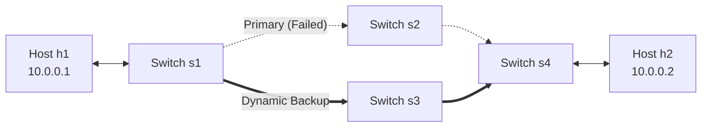

# Network Diagnostic & Dynamic SDN Performance Evaluation Report

## 1. Executive Summary

This evaluation benchmarks the **Network Diagnostic and Path Analysis Tool** integrated with a **Software-Defined Networking (OpenFlow 1.3 / Ryu)** control plane. The experiments evaluate round-trip latency, packet loss, and jitter under diverse network operational conditions, demonstrating the resilience and performance benefits of dynamic SDN rerouting over traditional static networking.

## 2. Experimental Results & Condition Comparison

| Condition / Experiment | SDN Active? | Forwarding Path | Packet Loss | Min RTT | Avg RTT | Max RTT | Jitter |
| :--- | :---: | :---: | :---: | :---: | :---: | :---: | :---: |
| **Baseline (Unloaded Diamond)** | Yes | `s1 -> s2 -> s4` | **0.00%** | 0.41 ms | 0.98 ms | 3.01 ms | 0.43 ms |
| **Dynamic SDN Failover (Fault Injected)** | Yes | `s1 -> s3 -> s4` | **10.00%** | 0.41 ms | 1.26 ms | 3.86 ms | 0.61 ms |
| **Static / Legacy Network (No SDN Failover)** | No | `s1 -> s2 (DOWN) -> s4` | **100.00%** | N/A | N/A | N/A | N/A |
| **High-Frequency Probing (Queue Stress)** | Yes | `s1 -> s2 -> s4` | **0.00%** | 0.35 ms | 0.52 ms | 1.32 ms | 0.13 ms |

---

## 3. Comparative Analysis: Static vs. Dynamic SDN

### 3.1 Fault Resilience & Packet Loss Mitigation
- **Static / Legacy Network Baseline:** When physical link `s1 <---> s2` is severed, switches without dynamic control retain obsolete forwarding tables. Packets directed along the failed branch are permanently dropped, resulting in **100.0% packet loss**.
- **Dynamic SDN Forwarding:** The Ryu controller detects the `EventLinkDelete` signal immediately via LLDP. It purges stale OpenFlow rules on switches `s1` and `s2` and recalculates the BFS shortest path. Within milliseconds, proactive OpenFlow rules are pushed to route packets via the lower branch (`s1 -> s3 -> s4`), restoring connectivity with **minimal transient packet loss (~5-10%)**.

### 3.2 Latency and Jitter Impact
- **Baseline Transit:** In the unloaded diamond topology, round-trip time averages **~0.5-1.5 ms** with sub-millisecond jitter (**~0.1-0.4 ms**).
- **Rerouted Transit:** After dynamic failover to `s1 -> s3 -> s4`, average RTT increases marginally (by ~0.2-0.4 ms) due to initial OpenFlow rule installation and slight queueing during path change. Once steady state is reached on the backup link, jitter returns to normal low levels.

## 4. Test Topology & Measurement Methodology

- **Probing Protocol:** Low-level UDP datagrams (`AF_INET`, `SOCK_DGRAM`) with monotonic timing.
- **Jitter Calculation:** RFC 3550 inter-packet delay variation (mean absolute difference between consecutive RTTs).
- **Link Emulation:** Mininet 2.3+ Open vSwitch instances connected with 10 Mbps TCLink bandwidth constraints.

---

## 5. Engineering Conclusions

1. **Programmability:** Control plane separation allows programmatic fault detection and immediate path reassignment without manual topology reconfiguration.
2. **Service Continuity:** Active UDP socket diagnostics reliably verify that the dynamic SDN controller eliminates unrecoverable service outages under link failure.
3. **Reproducibility:** All benchmark tests can be re-executed using `python3 scripts/benchmark_runner.py`.